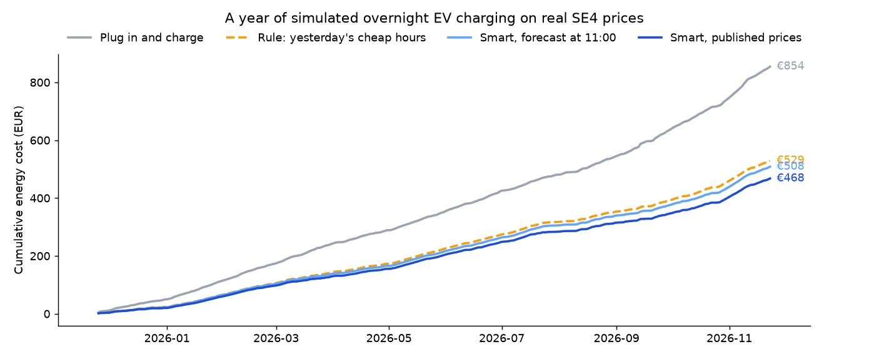
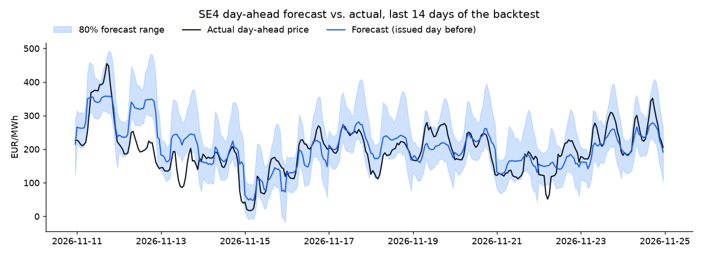

# CalmCharge

[](https://github.com/Pujitha-pitta/calmcharge/actions/workflows/tests.yml)

I built CalmCharge as a hands-on project to follow electricity-price data from download through analysis and into a charging plan. It uses public data for Sweden's SE4 region. I don't have a vehicle, so the EV in the planner is a simulation with example battery settings.

**Headline result:** over 364 real nights (25 Nov 2025 to 23 Nov 2026), charging a simulated EV with 15 kWh between 18:00 and 07:00 in the cheapest hours cut the energy cost by **45%** compared with plugging in and charging straight away. Planning at 11:00, *before* the next day's prices are published, using my day-ahead forecast still captured **90%** of that saving.



## What it does

1. **Downloads and cleans** SE4 day-ahead prices (Energi Data Service), SMHI weather and Swedish holidays into an hourly UTC table.
2. **Forecasts tomorrow's 24 hourly prices** at 11:00 the day before, using only information that was public at that moment, with an 80% likely range for each hour.
3. **Plans the charge**: picks the cheapest hours between plug-in and departure (windows can cross midnight), using published prices where they exist and the forecast where they don't.
4. **Backtests the savings** over a full year of nights and compares four strategies.
5. **Shows it all in a web app**: a FastAPI backend with a hand-built frontend.

## Day-ahead forecast

The forecast for day *T* is made at 11:00 on day *T−1*, just before the noon auction. At that moment the prices for *T−1* are already public, but nothing about *T* is. The features are prices for the same hour on *T−1*, *T−2* and *T−7*, the shape of the *T−1* price curve, and calendar facts about *T*. Validation is walk-forward: every day is forecast by a model trained only on earlier days and retrained weekly. A test corrupts a day's real prices and checks that its own forecast doesn't change.

Walk-forward results over 365 days (25 Nov 2025 to 24 Nov 2026), lower is better:

| Method | MAE (EUR/MWh) | RMSE (EUR/MWh) |
| --- | ---: | ---: |
| LightGBM | **28.41** | 42.01 |
| Ridge regression (NumPy) | 29.28 | **41.63** |
| Same hour, previous day | 38.39 | 55.61 |
| Same hour, 7-day average | 41.12 | 56.00 |
| Same hour, one week earlier | 50.77 | 72.02 |

LightGBM's average error is **26% lower** than the best simple baseline. The 80% range is built from the model's own recent out-of-sample errors. It held the real price **75%** of the time, slightly under the 80% target, so the ranges are a little too narrow.



## Savings backtest

Each evening a simulated EV plugs in at 18:00, needs 15 kWh in the battery by 07:00, and charges at 7.2 kW with 90% efficiency. Every strategy pays the real SE4 price:

| Strategy | Energy cost (EUR) | Saving |
| --- | ---: | ---: |
| Plug in and charge straight away | 854.38 | |
| Rule: reuse yesterday's cheapest hours | 528.99 | 38.1% |
| Smart, forecast locked in at 11:00 | 508.24 | 40.5% |
| Smart, published prices (after ~13:00) | 467.63 | 45.3% |

To be honest about it: most of the saving comes simply from moving charging into the night. The forecast beats the "yesterday's cheap hours" rule, but by a modest €21 a year at this usage. The forecast matters most when a plan has to be fixed before prices are published. These are energy-only market prices. Per-kWh grid fees and taxes are the same under every strategy, so they don't change the saving.

## Run it

Requires Python 3.11 or newer. In PowerShell, from the repository folder:

```powershell
py -3.11 -m venv .venv
.\.venv\Scripts\Activate.ps1
python -m pip install -r requirements.txt
pytest
```

Download prices, run the forecast backtest, then the savings backtest:

```powershell
python -m src.day_ahead --fetch
python -m src.backtest_savings --sek-per-eur 11.2
```

The first command downloads about two years of prices into `data/processed/se4_prices.csv` (this can take a few minutes) and writes results and charts to `reports/`. After that, `python -m src.day_ahead` reuses the cached prices.

### Web app

```powershell
python -m src.web
```

Open [http://127.0.0.1:8000](http://127.0.0.1:8000). The first start runs the year-long backtest (about a minute) and caches it. After that the app only downloads the newest prices. Change the battery, charger, plug-in and departure times, or add your own household tariff in SEK. The plan, the savings for the past year and the forecast update as you type. The JSON API is documented at `/api/docs`.

The app never connects to or controls a real car or charger. Cost results are estimates based on the values you enter, and fixed monthly charges are excluded.

## Earlier experiments

Before the day-ahead model, I compared a one-hour-ahead ridge model with simple baselines (`src/train_model.py`, `src/validate_model.py`). With expanding-window validation it scored MAE 14.41 EUR/MWh against 40.10 for "same hour yesterday". Those predictions used the price from one hour earlier, which isn't available when the day-ahead market closes, so they couldn't drive a real charging plan. That's why I built the day-ahead forecast. `src/explore.py` draws price profiles by hour, weekday and month. `src/plan_charge.py` and `src/plan_live_charge.py` are the first command-line planners, and `src/dashboard.py` is a dependency-free local dashboard.

## What I learned

The most useful part of this project was seeing how much care a time-series project needs before modeling: prices arrive in different market formats, source timestamps use Denmark's local time, and the finished schedules need to make sense in Sweden's local time. I store the data in UTC and convert it for display. Daylight-saving days have 23 or 25 hours, so the forecast works on a 24-column grid per Swedish day and maps back to real clock hours.

The step from a one-hour-ahead model to a true day-ahead one taught me the most. The earlier model looked far more accurate, but only because it had information a real forecaster wouldn't have. Defining exactly what is known at 11:00 the day before, and testing that the model can't see past it, made the results smaller but honest. The savings backtest also showed that a simple rule gets you most of the way. That's worth knowing before adding complexity.

## What I would improve next

- Add archived weather forecasts (wind and temperature drive SE4 prices) as issued at the forecast cutoff.
- Calibrate the forecast ranges so 80% ranges hold the price 80% of the time.
- Host the web app publicly with a scheduled daily price refresh.
- Check the cost calculation against a real electricity bill.

## Data sources

- [Energi Data Service API](https://api.energidataservice.dk/): SE4 day-ahead prices ([API guide](https://energidataservice.dk/guides/api-guides))
- [SMHI Meteorological Observations API](https://opendata.smhi.se/metobs/): historical hourly weather observations

## Project layout

```
src/ingest.py              Download, normalize, validate and store prices and weather
src/day_ahead.py           Day-ahead forecast, walk-forward validation, prediction ranges
src/charging.py            Cheapest-hour charging optimizer (windows can cross midnight)
src/backtest_savings.py    Year-long savings simulation of four charging strategies
src/web.py                 FastAPI backend for the web app
web/                       Frontend: index.html, style.css, app.js
src/explore.py             Exploratory charts
src/train_model.py         Earlier one-hour-ahead ridge model
src/validate_model.py      Expanding-window validation of that model
src/plan_charge.py         First historical planner (command line)
src/plan_live_charge.py    First live planner (command line)
src/dashboard.py           Dependency-free local dashboard
tests/                     Data, forecast-leakage, optimizer, backtest and API tests
docs/                      Charts used in this README
```

## Notes on Windows Application Control

On some Windows machines, Smart App Control blocks compiled Python libraries. On mine it blocks pyarrow's Parquet module. The forecast and web app therefore cache prices as plain CSV, read Parquet only when it is available, and fall back to the NumPy ridge model if LightGBM can't load.
